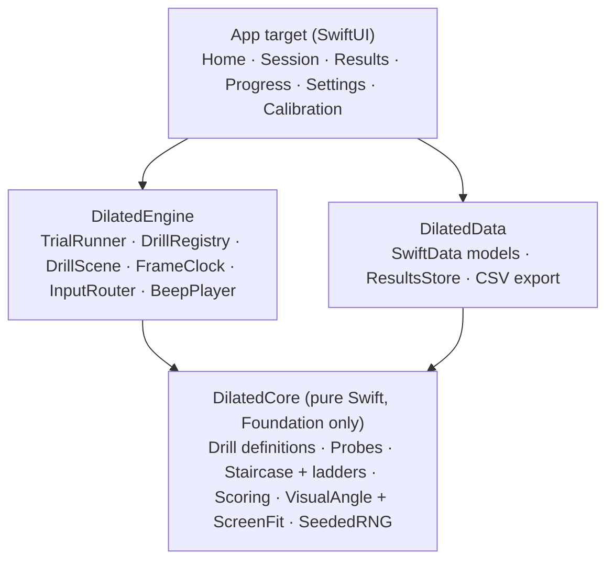
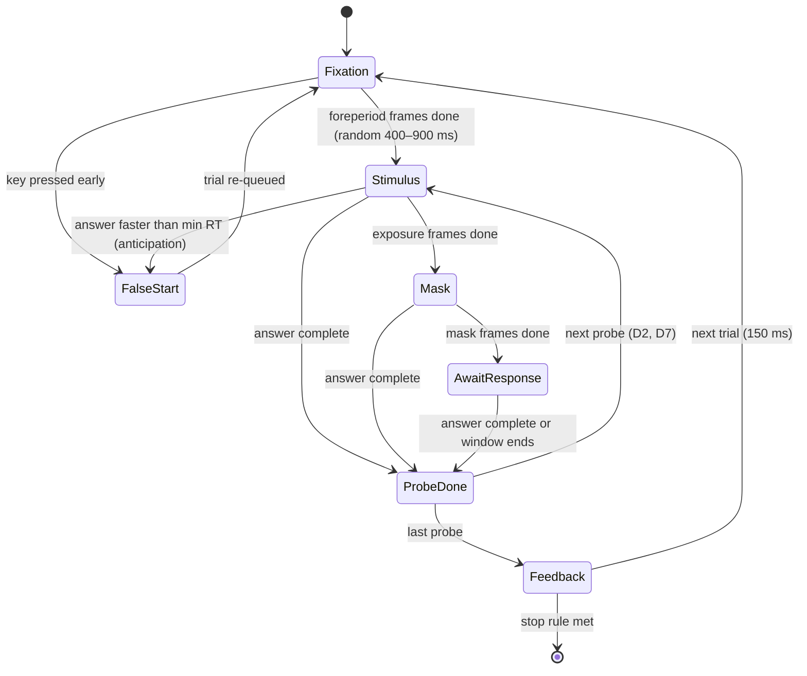

# Dilated — Architecture

> **What this is:** a macOS game that trains eye speed for practical shooting (USPSA).
> **Status:** Draft v0.2 · 2026-10-15 (changes in §20)
> **Name:** Dilated. Code modules use the `Dilated` prefix.

---

## 0. How to read this doc

1. Read **§1–§3** to learn what the app does and the words it uses (~10 min).
2. Read **§5–§7** to learn how the code is split up and how a drill plugs in (~15 min).
3. Read **§8.4 Timing** before writing any drill code. It is the part most likely to go wrong (~5 min).
4. Use **§17 Getting started** to create the project (~1 hour).

---

## 1. Goal

Train the visual skills that limit speed on a USPSA stage, and turn each one into a number you can watch improve.

| USPSA skill | What the eyes must do |
|---|---|
| Target transitions | Jump to the next target **before** the gun moves ("eyes lead") |
| Target acquisition | Land on the A-zone, not just "the target" |
| Shoot / no-shoot | Tell a valid target from a no-shoot or hard cover in a fraction of a second |
| Peripheral pickup | See the next target or an activated mover without looking straight at it |
| Movers | Read a swinger, drop-turner, or mover while it moves |
| Stage reading | Take in a whole target array quickly and remember the layout |

### Non-goals (v1)

- Not a shooting simulator. No gun, laser, or recoil.
- Not a medical or vision-therapy product.
- No accounts, cloud sync, or network access.

---

## 2. Drills at a glance

| # | Drill | USPSA skill | Player input | What gets harder | Main score | Phase |
|---|---|---|---|---|---|---|
| D1 | **Flash Acquire** | Acquisition | Arrow keys | Shorter exposure | Acquire threshold (ms) ↓ | MVP |
| D2 | **Transition Ladder** | Transitions | Arrow keys | More targets, wider spacing, shorter exposure | Splits (s) ↓, hit factor ↑ | MVP |
| D3 | **No-Shoot Discriminator** | Shoot / no-shoot | Space bar (go / no-go) | Shorter window, overlapping no-shoots, hard cover | Median RT ↓, false-alarm rate ↓, d′ ↑ | MVP |
| D4 | **Peripheral Pickup** | Peripheral pickup | Letter key (H J K L) + direction key | Shorter exposure | Pickup threshold (ms) ↓ | 2 |
| D5 | **Mover Read** | Movers | Arrow keys | Faster target | Speed at threshold (°/s) ↑ | 2 |
| D6 | **Stage Scan** | Stage reading | Mouse clicks | Shorter exposure | Recall % ↑, threshold (ms) ↓ | 2 |
| D7 | **Schulte Grid** | Warm-up / visual search | Mouse clicks | Bigger grid (setting) | Completion time (s) ↓ | 2 |

- Drills that report a threshold move **one** value on a ladder (§7.2). Other knobs, like D4's angle or D6's target count, are per-run settings.
- Every range is trimmed to what fits on the calibrated screen (§7.3).

Full specs are in **§9**.

---

## 3. Words you need to know

| Term | Meaning in this project |
|---|---|
| **Saccade** | A fast jump of the eyes from one spot to another. This is the "eye speed" we train. |
| **Fovea** | The small center of your vision. It is the only part sharp enough to read small detail. |
| **Tumbling E** | The letter **E** drawn facing up, down, left, or right. The player presses the matching arrow key. Chance of guessing right = 25%. |
| **Probe** | One thing to answer inside a trial. Most drills have one probe per trial; D2 has one per target, D7 one per number. |
| **Exposure** | How long a probe stays on screen. |
| **Mask** | A pattern drawn right after the stimulus disappears. It wipes out the afterimage so the exposure time is real. |
| **Stimulus onset** | The moment a probe first appears on the glass. All reaction times start here. |
| **RT (reaction time)** | Time from stimulus onset to the player's key press. |
| **Anticipation** | An answer faster than a human can react (default < 120 ms after onset). It is a guess, so it counts as a false start. |
| **Frame** | One screen refresh. 60 Hz = 16.7 ms per frame. 120 Hz (ProMotion) = 8.3 ms per frame. |
| **Ladder** | The list of values (e.g. exposure in ms) a drill steps through, easiest first. Log-spaced and rounded to whole frames. |
| **Staircase** | An adaptive rule. Right answers make the next trial harder; wrong answers make it easier. It settles on the player's limit. |
| **Threshold** | The ladder value where the player is right about 79% of the time. This is the main "eye speed score". |
| **Visual angle (°)** | How big something looks to the eye, in degrees. It does not depend on screen size, so scores compare across Macs. |
| **Eccentricity** | How far (in °) a stimulus is from where the player is looking. |
| **Field of view (FOV)** | How many degrees the screen covers from where the player sits. It limits how far apart targets can be. |
| **Hit factor** | USPSA score: points ÷ time. Higher is better. |
| **d′ (d-prime)** | A score for yes/no decisions that rewards hits and punishes false alarms at the same time. |

---

## 4. Platform and tech stack

| Concern | Choice | Notes |
|---|---|---|
| OS | macOS 14 Sonoma or later | Needed for SwiftData and `NSView.displayLink` (used by the Metal frame clock and the timing self-test). |
| Hardware | Apple Silicon Mac | 120 Hz ProMotion display preferred; 60 Hz supported. |
| Language | Swift 6, strict concurrency on | |
| App shell / menus | SwiftUI | |
| Drill rendering | SpriteKit (`SKScene` inside `SpriteView`) | Swap path to Metal in §8.4. |
| Frame timing | SpriteKit frame loop (v1 default); `CADisplayLink` + `SKRenderer` + `MTKView` (self-test always, drills as fallback) | See §8.4. |
| Input | `NSEvent` local monitors | Uses the hardware event timestamp. |
| Audio | `AVAudioEngine` | Start beep, like a shot timer. |
| Storage | SwiftData (SQLite on disk) | Local only. |
| Charts | Swift Charts | Progress screen. |
| Tests | Swift Testing (`import Testing`), XCTest for UI tests | |
| App category | Games | Turns on macOS Game Mode in full screen (§8.4). |
| Third-party dependencies | **None in v1** | |

---

## 5. High-level architecture

The code is split into four layers. **Arrows only point down.** A lower layer never imports a higher one.



| Layer | Knows about | Does NOT know about |
|---|---|---|
| **DilatedCore** | Math, rules, data shapes | Screens, SpriteKit, disk |
| **DilatedEngine** | Frames, keys, sound, drawing | Disk, SwiftUI screens |
| **DilatedData** | Saving and loading | Drawing, timing |
| **App** | Everything above | — |

Rule of thumb: if code can be tested without a screen, it goes in **DilatedCore**.

---

## 6. Repository layout

```text
dilated/                                ← repo root
├── arch.md                             ← this file
├── README.md
├── LICENSE                             ← MIT
├── .gitignore
├── App/                                ← Xcode project (folder renamed from "Dilated", see §17)
│   ├── Dilated.xcodeproj
│   ├── Dilated/                        ← macOS app target sources
│   │   ├── DilatedApp.swift
│   │   ├── Screens/
│   │   │   ├── HomeView.swift
│   │   │   ├── DrillPickerView.swift
│   │   │   ├── SessionView.swift       ← full-screen drill view + HUD
│   │   │   ├── ResultsView.swift
│   │   │   ├── TrainingProgressView.swift  ← not "ProgressView": that name hides SwiftUI's spinner
│   │   │   ├── CalibrationView.swift
│   │   │   └── SettingsView.swift
│   │   └── Resources/
│   │       ├── Assets.xcassets         ← target art, icons
│   │       └── Sounds/                 ← beep.caf
│   ├── DilatedTests/
│   └── DilatedUITests/
└── Packages/
    ├── DilatedCore/
    │   ├── Package.swift
    │   ├── Sources/DilatedCore/
    │   │   ├── Models/             ← TrialSpec, Probe, ProbeOutcome, TrialEvaluation, PlayerInput, DrillID, ScoreZone
    │   │   ├── Drills/             ← one file per drill: generator + answer parser + evaluator
    │   │   ├── Adaptive/           ← Staircase.swift, Ladder.swift, AdaptivePolicy.swift
    │   │   ├── Scoring/            ← HitFactorScorer.swift, Stats.swift
    │   │   ├── Geometry/           ← DisplayGeometry.swift, VisualAngle.swift, ScreenFit.swift, RealWorldScale.swift
    │   │   └── Random/             ← SeededRNG.swift
    │   └── Tests/DilatedCoreTests/
    ├── DilatedEngine/
    │   ├── Package.swift
    │   ├── Sources/DilatedEngine/
    │   │   ├── Runner/             ← TrialRunner.swift, DrillRunning.swift, DrillRegistry.swift, RunnerState.swift
    │   │   ├── Rendering/          ← DrillScene.swift, TargetNode.swift, MaskNode.swift
    │   │   ├── Timing/             ← FrameClock.swift, SpriteKitFrameClock.swift, MetalFrameClock.swift, TimingSelfTest.swift
    │   │   ├── Input/              ← InputRouter.swift, KeyBindings.swift
    │   │   └── Audio/              ← BeepPlayer.swift
    │   └── Tests/DilatedEngineTests/
    └── DilatedData/
        ├── Package.swift
        ├── Sources/DilatedData/
        │   ├── Schema/             ← SchemaV1.swift, MigrationPlan.swift
        │   ├── ResultsStore.swift
        │   └── CSVExporter.swift
        └── Tests/DilatedDataTests/
```

`DilatedCore` tests run with `swift test` in a few seconds and need no app window.

---

## 7. Core layer — `DilatedCore`

### 7.1 The drill contract

Every drill is a value type that does three jobs: **make a trial**, **turn key presses into an answer**, and **grade the answers**. It never draws anything.

A trial is a list of **probes**. Most drills have one. D2 has one per target (so each split gets its own RT), and D7 has one per number.

```swift
public protocol DrillDefinition: Sendable {
    associatedtype Stimulus: Sendable & Codable
    associatedtype Response: Sendable & Codable & Equatable

    static var id: DrillID { get }
    static var version: Int { get }              // bump when trial generation or par changes
    var policy: AdaptivePolicy { get }           // staircase or fixed, plus the stop rule (§7.2)

    /// Build the next trial. `fit` says what the calibrated screen can show (§7.3).
    func makeTrial(difficulty: Int, fit: ScreenFit, rng: inout SeededRNG) -> TrialSpec<Stimulus, Response>

    /// Turn the inputs received so far for one probe into an answer.
    /// D4 returns `.incomplete` until it has both a letter and a direction.
    func parse(_ inputs: [PlayerInput], for probe: Probe<Response>) -> AnswerParse<Response>

    /// Grade one finished trial. `answers[i]` is the answer to probe i, or nil if none came in time.
    func evaluate(_ spec: TrialSpec<Stimulus, Response>,
                  answers: [ProbeAnswer<Response>?]) -> TrialEvaluation
}

public struct TrialSpec<Stimulus: Sendable & Codable, Response: Sendable & Codable & Equatable>: Sendable, Codable {
    public var stimulus: Stimulus                // everything drawn during the trial
    public var foreperiodFrames: Int             // fixation time before the first probe (randomized)
    public var probes: [Probe<Response>]         // shown in order
}

public struct Probe<Response: Sendable & Codable & Equatable>: Sendable, Codable {
    public var expected: Response?               // nil = correct action is "do nothing" (no-shoot)
    public var start: ProbeStart                 // .afterForeperiod or .afterPreviousAnswer
    public var exposureFrames: Int               // how long this probe is visible
    public var maskFrames: Int
    public var responseWindowFrames: Int         // counted from this probe's onset
    public var minRTSeconds: Double = 0.12       // faster = anticipation (§8.1); D7 uses 0
}

public enum AnswerParse<Response: Sendable>: Sendable {
    case ignored                                 // this input means nothing for this probe
    case incomplete                              // keep collecting (D4, D6, D7)
    case complete(Response)
}

public struct ProbeAnswer<Response: Sendable & Codable & Equatable>: Sendable, Codable {
    public var response: Response
    public var rtSeconds: Double                 // this probe's onset → the input that completed the answer
}

public enum ProbeOutcome: String, Sendable, Codable {
    case correct, wrong, noAnswer, shotNoShoot, withheld
}

public struct TrialEvaluation: Sendable, Codable {
    public var outcomes: [ProbeOutcome]          // one per probe; zones come from scoring (§7.4)
    public var countsForStaircase: Bool
    public var correctForStaircase: Bool
}
```

`PlayerInput` lives in DilatedCore so drills can read it. Key codes stay in DilatedEngine (`KeyBindings`, §8.5).

```swift
public struct PlayerInput: Sendable, Codable {
    public var action: PlayerAction              // .direction(Direction), .shoot, .letter(String), .click(xDeg:yDeg:)
    public var timestamp: Double                 // NSEvent.timestamp, system-uptime seconds
}
```

**How each drill maps onto probes:**

| Drill | Probes per trial | Next probe starts | An answer is | Staircase |
|---|---|---|---|---|
| D1 Flash Acquire | 1 | after the foreperiod | one arrow | yes, reports a threshold |
| D2 Transition Ladder | one per target (3–8) | right after the previous answer | one arrow | yes, no threshold; an array is correct only if every target was read right |
| D3 No-Shoot | 1 | after the foreperiod | Space, or nothing | yes, with a false-alarm gate (§9) |
| D4 Peripheral Pickup | 1 | after the foreperiod | a letter **and** a direction, either order | yes, reports a threshold |
| D5 Mover Read | 1 (the E flash) | after the foreperiod, while the target moves | one arrow | yes, reports a threshold |
| D6 Stage Scan | 1 | after the foreperiod | clicks, then Space to finish | yes, reports a threshold |
| D7 Schulte Grid | 25 | right after the previous answer | a click on the right cell (wrong clicks before it are counted in the answer) | no — fixed grid size |

`TrialRunner` is generic over the drill. The app never sees that type: it holds `any DrillRunning` (§8.2). Drill values are built per run with the display's geometry and the player's settings.

### 7.2 Staircase and ladders (adaptive difficulty)

**Ladders.** A drill's integer `difficulty` (0 = easiest) is an index into a ladder of real values.

1. A drill that reports a threshold moves **one** value on its ladder (exposure in ms, or speed in °/s). Everything else is fixed for the run, so the threshold has one unit.
2. Ladder values are **log-spaced**: each level is the same *ratio* harder. Default: 0.05 log₁₀ units (~11%) per level. Equal-ms steps would be huge at the short end and meaningless at the long end.
3. Exposure ladders are built **per display**: convert each value to whole frames (§8.4), drop duplicates, and stop at the display's `minExposureFrames`. D1's ladder (500 ms down to 1 frame) has about 25 levels at 120 Hz and 19 at 60 Hz.
4. Store and compare thresholds in **ms (or °/s), never in levels**. Level 10 means different things on different displays.

**Staircase rules:**

1. **Fast start:** step 4 levels harder after **each** correct answer, until the first wrong answer. From 500 ms this reaches a typical limit in 3–4 trials.
2. Then **3-down / 1-up**: three right in a row → one step harder. One wrong → one step easier. This settles at ~79% correct.
3. A **reversal** is when the direction changes (harder → easier, or easier → harder). The fast start's first wrong answer is reversal 1.
4. Step size is 4 levels until 2 reversals have happened, then 1 level.
5. Stop at the drill's stop rule. Default: 40 trials **or** 12 reversals, whichever comes first.
6. **Threshold** = geometric mean of the ladder values at the last 6 **small-step** reversals. The big-step reversals are too coarse to use.
   - With 4–5 small-step reversals, use those.
   - With fewer than 4, the run has no threshold. Save it, show "Not enough data for a threshold", and leave `threshold = nil`.
7. The next session starts 8 levels (two big steps) easier than the last threshold, looked up on this display's ladder. The first session starts at level 0.

```swift
public enum AdaptivePolicy: Sendable {
    case staircase(ladder: Ladder, stop: StopRule, reportsThreshold: Bool)
    case fixed(difficulty: Int, stop: StopRule)     // D7, warm-ups
}

public struct StopRule: Sendable, Codable {
    public var maxTrials: Int                       // e.g. 40 (D1), 10 arrays (D2), 1 grid (D7)
    public var maxReversals: Int?                   // e.g. 12; nil = trials only
}

public struct Staircase: Sendable, Codable {
    public private(set) var difficulty: Int
    public private(set) var reversals: [Reversal] = []   // difficulty + step size at that moment
    let ladder: Ladder
    let stop: StopRule
    var inFastStart = true
    var streak = 0
    var lastMove: Move? = nil          // .harder or .easier

    public mutating func record(correct: Bool) { /* rules above */ }
    public var isFinished: Bool { /* stop rule */ }
    public var threshold: Double? { /* geometric mean of last 6 small-step reversals; nil if < 4 */ }
}
```

### 7.3 Visual angle, calibration, and screen fit

All sizes and positions in drills are in **degrees**. The renderer converts degrees to screen points.

```swift
/// Plain description of the display. DilatedData stores it (§11); DilatedCore only sees this struct.
public struct DisplayGeometry: Sendable, Codable {
    public var pointsPerMM: Double
    public var viewingDistanceMM: Double
    public var refreshHz: Double
    public var minExposureFrames: Int            // from the slow-motion check (§15.2); default 1
}

/// Size on screen (points) for a size in degrees.
/// points = 2 · distanceMM · tan(degrees / 2) · pointsPerMM
public func points(forDegrees deg: Double, geometry: DisplayGeometry) -> Double {
    2 * geometry.viewingDistanceMM * tan(deg * .pi / 360) * geometry.pointsPerMM
}
```

**Calibration steps (once per display):**

1. Read the physical size with `CGDisplayScreenSize(displayID)` (returns mm) as a first guess.
2. Show a rectangle on screen. The player holds a credit card (ISO ID-1, **85.60 mm** wide) against the glass and drags a slider until the rectangle matches. Store `pointsPerMM`.
3. The player measures eye-to-screen distance with a tape measure and types it in (default **600 mm**).
4. Run the timing self-test (§8.4). Store the refresh rate, present latency, and clock choice.
5. Save as a `DisplayCalibration` record keyed by display (name + resolution). DilatedData turns it into a `DisplayGeometry` for the drills.

**Screen fit.** A screen only covers so many degrees. Drills must stay inside it.

```swift
/// What the screen can show, in degrees from screen center. Built from the drill view's real size,
/// not the panel size: on notched MacBooks, full screen loses the strip beside the notch.
public struct ScreenFit: Sendable {
    public var halfWidthDeg: Double      // atan((viewWidthPoints / pointsPerMM / 2) / viewingDistanceMM)
    public var halfHeightDeg: Double
    public var marginDeg: Double = 1
}
```

| Display | Panel (mm) | Field of view at 600 mm (whole panel) |
|---|---|---|
| 14″ MacBook Pro | 302 × 196 | 28° × 18.6° (±14.1°, ±9.3°) |
| 16″ MacBook Pro | 346 × 223 | 32° × 21° (±16.1°, ±10.5°) |
| 27″ Studio Display | 597 × 336 | 53° × 31° (±26.4°, ±15.6°) |

1. Generators get the `ScreenFit` and place everything inside it, minus the margin.
2. Each drill trims its difficulty range at runtime to what fits. Example: D2 at 5° spacing fits about 5–6 targets on a 14″ MacBook Pro, not 8. At 25° spacing, only 2–3 targets fit even on a 27″.
3. If a drill's easiest setting does not fit (e.g. D4 needs at least 6° in all 8 directions), the drill picker says "Sit closer or use a larger display" and shows the distance that would work: `distanceMM = halfHeightMM / tan(neededDeg)`.

**Real-world scale mode:** the player types a target distance and spacing in yards. The app sizes targets to the same visual angle they would have on the range.

```text
angle = 2 · atan( (size / 2) / distance )

USPSA target, 18 in wide, at 10 yd  →  2 · atan(9 / 360)  ≈ 2.86°  (≈ 30 mm on screen at 60 cm)
A-zone,       ~6 in wide, at 10 yd  →  2 · atan(3 / 360)  ≈ 0.95°  (≈ 10 mm on screen at 60 cm)
```

- If the array does not fit on screen, show a warning and offer: (a) sit closer, or (b) shrink spacing.
- **Before shipping:** confirm zone sizes against the official target drawing in the USPSA rulebook, Appendix B1. The A-zone value above is approximate.

### 7.4 Scoring — USPSA-style overlay

This is a **game score only**, not an official USPSA score.

| Result | Zone | Minor | Major |
|---|---|---|---|
| Correct, RT ≤ par | A | +5 | +5 |
| Correct, RT ≤ 1.5 × par | C | +3 | +4 |
| Correct, RT > 1.5 × par | D | +1 | +2 |
| Wrong answer, or no answer on a shoot target | Miss | −10 | −10 |
| Answered on a no-shoot | No-shoot | −10 | −10 |
| Correctly held fire on a no-shoot | Withheld | 0 | 0 |

1. **Par** is fixed per drill and difficulty, set in the drill definition. A par that followed the player's own RT would move with them: the A/C/D mix would stay flat as they improved, and each month would be scored against a different par.
2. Changing a par is a drill version bump (`DrillDefinition.version`). The Progress screen only compares hit factors within one version.
3. Results also show **"vs recent form"**: this run's median RT against the median of the player's last 5 sessions. That keeps the personal comparison without moving par.
4. **Zones** come from the drill's `ProbeOutcome` plus RT and par: `.correct` → A / C / D by RT; `.wrong` and `.noAnswer` → Miss; `.shotNoShoot` → No-shoot; `.withheld` → Withheld.
5. **Time** = sum of each probe's active time (onset → answer, or onset → window end).
6. **Hit factor** = `max(0, points) / time`, truncated (not rounded) to 4 decimals.
7. Power factor (Minor / Major) is a setting. It only changes C and D values.

### 7.5 Seeded randomness

- Use a small seeded generator (SplitMix64) that conforms to `RandomNumberGenerator`.
- Store the seed on every `DrillRun`. The same seed + same drill version = the exact same trials. Use this to replay a run while debugging.

### 7.6 Stats

| Stat | Used for |
|---|---|
| Median RT and IQR | All drills (median, not mean — one slow trial should not wreck the score) |
| Accuracy % | All drills |
| Threshold (ms or °/s, geometric mean of reversals — §7.2) | Staircase drills that report one |
| Splits | Transition Ladder |
| d′ = Z(hit rate) − Z(false-alarm rate) | No-Shoot Discriminator. Apply the log-linear fix (add 0.5 to counts) so rates of 0% or 100% do not break the math. |

---

## 8. Engine layer — `DilatedEngine`

### 8.1 How one run works

**Run level** (like a shot timer):

1. Show "**STANDBY**".
2. Wait a random 1.0–3.0 s.
3. Play the beep.
4. Loop through trials until the drill's stop rule is met (§7.2).
5. Show results.

**Trial level:**



1. **Fixation** — a small cross shows where to look. The wait is random so the player cannot predict onset.
2. **Stimulus** — the probe appears (in D1, the target and its E). Responses count from here.
3. **Mask** — the E is covered by a pattern. The target silhouette stays.
4. **Await response** — the player still has time to answer until the window ends.
5. **Next probe** — in D2 and D7 the next probe starts as soon as the previous one is answered. Other drills have one probe per trial.
6. **Feedback** — a short flash on the target: green ring = hit, red ✕ = miss. The shape carries the meaning, so color-blind players can read it.
7. **False start** — a key press during fixation, or an answer faster than the probe's `minRTSeconds` (default 120 ms). Nobody reacts that fast, so it is a guess. The trial does not count and is put back in the queue.
8. **Too many invalid trials** — after 3 invalid trials in a row (false starts or dropped frames), pause and say why: "Wait for the target" or "Frames are being dropped — close other apps". After 10 invalid trials in one run, end it with `endReason = "aborted"`. Aborted runs are saved but never count toward thresholds, PBs, or "vs last time".

### 8.2 `TrialRunner`

One `TrialRunner` drives one drill run. It is called **once per frame** and **once per input event**. It never uses `Timer` or `DispatchQueue.asyncAfter` for stimulus timing — everything counts frames.

```swift
@MainActor @Observable
public final class TrialRunner<Drill: DrillDefinition>: DrillRunning {
    public private(set) var state: RunnerState = .idle
    public private(set) var results: [TrialResult] = []   // kept in memory during the run

    private let drill: Drill
    private var staircase: Staircase?                      // nil for .fixed drills
    private var rng: SeededRNG
    private let scene: DrillScene

    public func onFrame(_ tick: FrameTick) { /* advance state by one frame */ }
    public func onPresented(frameIndex: Int, presentedTime: Double) { /* fill in Onset.presented */ }
    public func onInput(_ input: PlayerInput) { /* collect, parse, grade; uses input.timestamp */ }
}

/// What the app holds. Lets one program run D1, D2 and D3 in a row without knowing their types.
@MainActor
public protocol DrillRunning: AnyObject {
    var drillID: DrillID { get }
    var isFinished: Bool { get }
    func onFrame(_ tick: FrameTick)
    func onPresented(frameIndex: Int, presentedTime: Double)
    func onInput(_ input: PlayerInput)
    func outcome() -> RunOutcome          // plain Sendable structs, stimulus already JSON-encoded
}

/// The only `switch` over drill IDs in the app.
@MainActor
public enum DrillRegistry {
    public static func makeRunner(for id: DrillID, setup: RunSetup) -> any DrillRunning
    // RunSetup: display geometry, screen fit, settings, seed, start difficulty
}

public enum RunnerState: Sendable {
    case idle
    case standby(beepAt: Double)
    case fixation(framesLeft: Int)
    case stimulus(probe: Int, onset: Onset, framesLeft: Int)
    case mask(probe: Int, onset: Onset, framesLeft: Int)
    case awaitingResponse(probe: Int, onset: Onset, framesLeft: Int)
    case feedback(framesLeft: Int)
    case paused(reason: PauseReason)      // too many invalid trials, or Esc
    case finished
}

public struct Onset: Sendable {
    public var frameIndex: Int            // the frame where the probe first became visible
    public var estimated: Double          // from the frame tick, known right away
    public var presented: Double?         // real on-glass time, filled in later by MetalFrameClock
    public var best: Double { presented ?? estimated }
}

public struct FrameTick: Sendable {
    public var index: Int
    public var timestamp: Double      // expected on-glass time, system-uptime seconds
    public var duration: Double       // seconds per frame
}
```

At the end of a run, the runner returns a `RunOutcome`: plain `Sendable` structs, with each stimulus already encoded to JSON. The app passes it to `ResultsStore` (§11) in one call. No disk writes happen during trials, and SwiftData `@Model` objects never reach the runner.

### 8.3 Rendering

1. One base class `DrillScene: SKScene`. Each drill subclasses it and builds its own nodes.
2. **Create every node before the beep** and keep it hidden. Showing a stimulus = set `isHidden = false`. No new objects during trials.
3. Preload all textures before the beep (`SKTexture.preload`).
4. Run full screen. Hide the cursor during trials with `NSCursor.hide()` (except mouse drills).
5. Colors:
   - Background: neutral mid-gray.
   - Shoot target: cardboard tan.
   - No-shoot: white (plus a shape/outline difference, so it does not rely on color alone).
   - Hard cover: black.
   - Feedback: green ring (hit) / red ✕ (miss) — shape, not color alone.
6. Positions come from `DilatedCore` in degrees. The scene converts them with `VisualAngle`.

### 8.4 Timing — read this before writing drill code

**Rules:**

1. **One clock.** Use system uptime seconds: `CACurrentMediaTime()`. It shares a timebase with `NSEvent.timestamp` (the self-test checks this). Never use `Date()` for reaction time.
2. **Durations are whole frames.** `exposureFrames = round(ms / frameDurationMS)`. At 120 Hz, exposure steps are 8.3 ms; at 60 Hz, 16.7 ms. Ladders are rounded per display (§7.2).
3. **Onset** = the on-glass time of the first frame where the probe is visible. It starts as an estimate from the frame tick. With the Metal clock, the real presented time replaces it a frame or two later (`Onset.presented`).
4. **RT** = `input.timestamp − onset`. Use the event's own timestamp, not the time your code handled it. Compute RTs when the trial is graded (Feedback), so a late-arriving presented time is used. The anticipation check (§8.1) uses the estimate.
5. **Dropped frames:** during Stimulus or Mask, mark the trial invalid (`invalidReason = "dropped_frame"`) and re-queue it if:
   - the gap between two frame ticks is more than 1.5 × frame duration, or
   - with the Metal clock, a frame's `presentedTime` is 0 (never shown), or two presented times are more than 1.5 frames apart.
6. **Frame rate:** set `SKView.preferredFramesPerSecond = NSScreen.maximumFramesPerSecond`. Show a warning if it is below 60 or if `ProcessInfo.processInfo.isLowPowerModeEnabled` is true.
7. **Keep the Mac awake and fast during a session:**

   ```swift
   let activity = ProcessInfo.processInfo.beginActivity(
       options: [.userInitiated, .latencyCritical, .idleDisplaySleepDisabled],
       reason: "Training session")
   // ... run the session ...
   ProcessInfo.processInfo.endActivity(activity)
   ```

**Frame clock — two implementations behind one protocol:**

```swift
@MainActor
public protocol FrameClock: AnyObject {
    var onTick: ((FrameTick) -> Void)? { get set }
    /// Real on-glass time for a frame, delivered after the fact. Only MetalFrameClock calls it.
    var onPresented: ((_ frameIndex: Int, _ presentedTime: Double) -> Void)? { get set }
    var nominalFrameDuration: Double { get }
}
```

| Implementation | Who drives frames | Onset estimate (`FrameTick.timestamp`) | Real on-glass time | When to use |
|---|---|---|---|---|
| `SpriteKitFrameClock` (v1 default) | `SKView`'s own loop → `SKScene.update(_:)` | update time + measured present latency (from the self-test; 1 frame until measured) | — | Default. Simple. |
| `MetalFrameClock` | A `CADisplayLink` from `NSView.displayLink(target:selector:)` renders the same `SKScene` with `SKRenderer` into an `MTKView` | `link.targetTimestamp` | `drawable.addPresentedHandler { $0.presentedTime }`, a frame or two later | Timing self-test (always). Drills, when the self-test says so. |

`addPresentedHandler` runs on a background thread. `MetalFrameClock` copies the two numbers it needs (both `Sendable`) and hops to the main actor before calling `onPresented`:

```swift
drawable.addPresentedHandler { [weak self] drawable in
    let time = drawable.presentedTime                 // background thread
    Task { @MainActor in self?.onPresented?(frameIndex, time) }
}
```

The drills do not change when you swap clocks — only `DilatedEngine/Timing/` changes.

**Timing self-test (Calibration screen).** Part B always uses the Metal path, whatever clock the drills use, because it is the only way to see what really reached the glass.

1. **A — SpriteKit loop.** Run 600 frames with a flashing test square in the `SKView`. Check that `SKScene.update` time matches `CACurrentMediaTime()` (difference < 1 ms). Report tick-interval jitter.
2. **B — Real presentation.** Run 600 frames through `MetalFrameClock`. Report:
   - measured Hz and jitter of presented times (standard deviation),
   - frames never shown or late,
   - **present latency:** median `presentedTime − link.timestamp`, in frames. Store it. The SpriteKit clock uses it as its onset offset instead of a fixed +1 frame. It is a stand-in (SKView presents through the same `CAMetalLayer` path); the slow-motion check confirms it (§15.2).
3. **C — Input clock.** The player presses Space 10 times. For each press, `CACurrentMediaTime() − event.timestamp` must be between 0 and 50 ms. If not, event timestamps are on a different clock and RTs cannot be trusted; show an error.
4. **Pass:** B has jitter SD < 1 ms and 0 dropped frames, A's clocks match, and C passes.
   - B passes but A's tick jitter is above 1 ms → use `MetalFrameClock` for drills on this display.
   - B fails → show the result and recommend closing other apps, turning off Low Power Mode, or trying another display.

**Known latency and display limits you cannot remove:**

- Keyboards add their own delay. Bluetooth adds more. Recommend a wired keyboard.
- The beep starts the run only. It is never part of an RT, because audio output (especially Bluetooth headphones) adds delay.
- Save the display and input device on every session. Compare scores only across the same setup.
- **Pixels are not instant.** LCD pixels take time to change. On slow panels (MacBook Pro mini-LED panels are slow by gaming-monitor standards), a 1–2 frame exposure is a smeared fade, not a clean flash. The mask limits the damage. The slow-motion check (§15.2) finds each display's `minExposureFrames`, and exposure ladders stop there.
- **Game Mode.** The app is in the Games category (§17), so macOS turns on Game Mode in full screen: CPU/GPU priority, and lower Bluetooth latency for controllers and AirPods. It does not help keyboard latency.

### 8.5 Input

1. `InputRouter` installs `NSEvent.addLocalMonitorForEvents(matching: [.keyDown, .leftMouseDown])`.
2. While a run is active, return `nil` from the monitor for every event except ⌘ shortcuts. Otherwise AppKit plays the system alert sound for keys nobody handles, and Space can press whatever SwiftUI control has focus.
3. Ignore key repeats (`event.isARepeat == true`).
4. Turn each event into a `PlayerInput` (§7.1) using `KeyBindings`, with `timestamp = event.timestamp`. Mouse clicks become degrees from screen center. Pass it to the runner's `onInput`.
5. Default key bindings (all can be changed in Settings):

| Action | Key |
|---|---|
| E direction | ← ↑ → ↓ |
| Shoot (go / no-go), finish recall (D6) | Space |
| Center letter (D4) | H J K L (right hand) |
| Peripheral direction (8-way, D4) | Q W E / A D / Z X C (left hand, S unused) or numpad 1–9 (5 unused) |
| Pause / quit run | Esc |

6. Settings refuses a binding that would put one key on two actions in the same drill. By default D4's letter keys and direction keys never overlap, so its two answers can come in either order.
7. Game controller support (`GameController` framework) is Phase 3.

### 8.6 Audio

1. Load the beep into an `AVAudioPCMBuffer` at app start.
2. Keep one `AVAudioEngine` + `AVAudioPlayerNode` running during a session so the first beep is not late.
3. The beep is a short, loud tone like a shot timer. Volume is a setting.

---

## 9. Drill specs

Every drill uses the trial flow from §8.1 and the probe model from §7.1. Most use the staircase from §7.2; D2 and D7 differ (see their specs). Only these parts differ.

### D1 — Flash Acquire (MVP)

- **Trains:** getting the eyes onto the A-zone of a new target.
- **Screen:**
  1. A fixation cross at a random spot on screen.
  2. A target silhouette appears **10° or more** away from the cross, inside the screen fit (§7.3).
  3. A Tumbling E sits in the A-zone. Default E height: **0.25°** (too small to read without looking straight at it).
- **Flow:** fixation → target + E appear → after the exposure, the E is masked (the silhouette stays) → answer.
- **Input:** arrow key for the E's direction.
- **Difficulty → value:** exposure on a log ladder from 500 ms (difficulty 0) down to the display's shortest exposure (§7.2). About 25 levels at 120 Hz, 19 at 60 Hz.
- **Main score:** **Acquire threshold (ms)** — the exposure where you are right 79% of the time. Lower = faster eyes.
- **Trials:** 40 per run (~2 min).

### D2 — Transition Ladder (MVP)

- **Trains:** target-to-target transitions with the eyes leading.
- **Screen:** 3–8 silhouettes in a row or arc, numbered in shooting order. Only layouts that fit the screen are used (§7.3).
- **Flow:**
  1. The array appears with a fixation cross on target 1. Wait a random foreperiod.
  2. An E appears on target 1. The first split starts here — not at the beep, which is never part of an RT (§8.4).
  3. When the player answers, the E on the next target appears at once (one probe per target, §7.1).
  4. A wrong answer counts as a miss; the sequence continues.
  5. After the last target, show the result.
- **Input:** arrow keys.
- **Difficulty → value:** a table of rows (target count, spacing 5°–25°, E exposure) from easy to hard, trimmed at runtime to the rows that fit the screen. The staircase moves through the rows. An array counts as correct only if every target was read right. D2 does not report a threshold.
- **Main score:** **splits** shown like a shot timer (`1.12 | 0.31 | 0.29 | 0.34`), total time, and hit factor.
- **Real-world mode:** build the array from distance and spacing in yards (§7.3).
- **Stop rule:** 10 arrays per run (~3 min).

### D3 — No-Shoot Discriminator (MVP)

- **Trains:** shoot / no-shoot decisions.
- **Screen:** one target flashes at a random spot: a shoot target (tan) or a no-shoot (white).
- **Mix:** 70% shoot, 30% no-shoot (random order).
- **Input:** press **Space** for a shoot target. Do nothing for a no-shoot.
- **Difficulty → value:**
  - Levels 0–3: full targets, shrinking response window.
  - Levels 4–6: a no-shoot partly overlaps the shoot target.
  - Levels 7+: hard cover hides part of the target; shorter exposure.
- **False-alarm gate:** the staircase steps harder only if the false-alarm rate over the last 10 no-shoot trials (or all so far, if fewer) is 20% or lower. Otherwise three right in a row keep the level. Without the gate, a player who presses on a third of the no-shoots is still 90% correct — enough to keep stepping harder.
- **Main scores:** median RT on shoot targets, false-alarm rate (Space on a no-shoot), d′.
- **Trials:** 60 per run (~3 min).

### D4 — Peripheral Pickup (Phase 2)

- **Trains:** seeing targets out of the corner of the eye.
- **Screen:** a letter (H, J, K or L) at the center (forces the player to look there) + a small target in 1 of 8 directions. Distractor shapes are a setting.
- **Eccentricity:** the largest that fits in all 8 directions, up to the setting (default 10°, minimum 6°). On a 14″ MacBook Pro at 600 mm only about 7° fits vertically; at 450 mm, 10° fits.
- **Flow:** both appear → both masked after the exposure → answer.
- **Input:**
  1. Press the letter shown in the center (H J K L, right hand).
  2. Press the direction of the outer target (Q W E / A D / Z X C, left hand, or the numpad).
  3. The two key groups share no keys, so either order works.
- **Correct** only if both answers are right.
- **Difficulty → value:** exposure on a log ladder from 250 ms down. Eccentricity and distractor count are fixed for the run (settings).
- **Main score:** **pickup threshold (ms)**.

### D5 — Mover Read (Phase 2)

- **Trains:** reading moving targets (swingers, movers, drop-turners).
- **Screen:** a target moves side to side at a steady speed, or swings like a pendulum. An E flashes on it at a random time.
- **Input:** arrow keys.
- **Difficulty → value:** speed on a log ladder (°/s, going up). Exposure is fixed for the run (a setting), so the threshold is purely speed.
- **Main score:** **speed at threshold (°/s)** — higher is better.

### D6 — Stage Scan (Phase 2)

- **Trains:** reading a stage's target array fast and remembering it.
- **Screen:** shoot and no-shoot targets shown briefly, then a blank stage.
- **Input:** click where each **shoot** target was, then press Space to finish. A click counts if it lands within 2° of a target.
- **Correct** (for the staircase) only if every shoot target was found and no click missed.
- **Difficulty → value:** exposure on a log ladder. Target count (4–12) is fixed for the run (a setting).
- **Main scores:** recall %, exposure threshold.

### D7 — Schulte Grid (warm-up, Phase 2)

- **Trains:** visual search; good as a warm-up.
- **Screen:** a 5×5 grid with numbers 1–25 in random cells. A dot in the center.
- **Input:** click 1 → 25 in order. Each number is one probe. A wrong click is counted, and the player keeps looking.
- **No staircase.** Grid size is a setting. `minRTSeconds = 0`, since the player may already know where the next number is.
- **Main score:** completion time (s), with wrong clicks shown.

---

## 10. Sessions and programs

**Default program: "Daily 12" (~12 minutes)**

| Step | Drill | Length |
|---|---|---|
| 1 | Warm-up: Flash Acquire at easy difficulty (Schulte Grid once Phase 2 lands) | 1 min |
| 2 | Flash Acquire | 2 min |
| 3 | Rest | 20 s |
| 4 | Transition Ladder | 3 min |
| 5 | Rest | 20 s |
| 6 | No-Shoot Discriminator | 3 min |
| 7 | Results screen | 1–2 min |

- During each rest, prompt: "Look at something 20 ft away."
- A program is plain data (`ProgramDefinition`: a list of drill IDs + stop rules). The app turns each ID into a runner with `DrillRegistry` (§8.2), so new programs need no new code.

---

## 11. Data layer — `DilatedData`

### 11.1 SwiftData models

```swift
@Model final class Profile {
    var name: String
    var createdAt: Date
    var powerFactor: String                       // "minor" | "major"
    @Relationship(deleteRule: .cascade) var calibrations: [DisplayCalibration] = []
    @Relationship(deleteRule: .cascade) var sessions: [Session] = []
}

@Model final class DisplayCalibration {
    var displayKey: String                        // display name + resolution
    var pointsPerMM: Double
    var viewingDistanceMM: Double
    var refreshHz: Double
    var presentLatencyFrames: Double              // from the self-test; onset offset for the SpriteKit clock
    var clock: String                             // "spritekit" | "metal"
    var minExposureFrames: Int                    // from the slow-motion check; default 1
    var calibratedAt: Date

    var geometry: DisplayGeometry { /* plain struct for DilatedCore (§7.3) */ }
}

@Model final class Session {
    var startedAt: Date
    var endedAt: Date?
    var programID: String
    var hardware: HardwareSnapshot                // Codable struct: display, Hz, input device, OS, app version
    @Relationship(deleteRule: .cascade) var runs: [DrillRun] = []
}

@Model final class DrillRun {
    var order: Int                                // position in the session
    var startedAt: Date
    var drillID: String
    var drillVersion: Int                         // bump when trial generation or par changes
    var seed: Int64                               // UInt64 seed stored as bit pattern
    var startDifficulty: Int
    var endDifficulty: Int
    var threshold: Double?                        // ms or °/s; nil if the drill has none or the run had < 4 small-step reversals
    var endReason: String                         // "finished" | "aborted" | "quit"
    var points: Int
    var timeSeconds: Double
    var hitFactor: Double
    @Relationship(deleteRule: .cascade) var trials: [TrialRecord] = []
}

@Model final class TrialRecord {
    var index: Int
    var difficulty: Int
    var stimulusJSON: Data
    var countsForStaircase: Bool
    var correctForStaircase: Bool
    var valid: Bool
    var invalidReason: String?                    // "dropped_frame" | "false_start" | "anticipation" | nil
    @Relationship(deleteRule: .cascade) var probes: [ProbeRecord] = []
}

@Model final class ProbeRecord {
    var index: Int
    var onsetUptime: Double                       // real on-glass time if known, else the estimate
    var onsetConfirmed: Bool                      // true = from presentedTime (Metal clock)
    var responseUptime: Double?
    var rtMS: Double?
    var answerJSON: Data?
    var outcome: String                           // "correct" | "wrong" | "no_answer" | "shot_no_shoot" | "withheld"
    var zone: String                              // "A" | "C" | "D" | "M" | "NS" | "W"
}
```

### 11.2 Rules

1. All writes go through `@ModelActor actor ResultsStore`, so saving never blocks the main thread.
2. The runner hands over a `RunOutcome` (plain `Sendable` structs). `ResultsStore` builds the `@Model` objects inside the actor. `@Model` objects never cross actors.
3. Save once per finished (or aborted) run, not once per trial.
4. SwiftData does not keep the order of to-many relationships. Always sort by `DrillRun.order`, `TrialRecord.index`, and `ProbeRecord.index` when reading.
5. Define the schema as `SchemaV1: VersionedSchema` and add a `SchemaMigrationPlan` from day one, so later changes do not wipe data.
6. Data lives in the app's sandbox container. Nothing leaves the Mac.
7. **Export:** File → Export… writes three CSV files (runs, trials, probes) using SwiftUI `fileExporter`.

---

## 12. App layer — screens

| Screen | Shows |
|---|---|
| **Home** | Today's program, big **Start** button, day streak, last 3 scores |
| **Drill picker** | Every drill with its personal best. A drill that does not fit the screen says how close to sit (§7.3). |
| **Session** | Full-screen drill view. HUD hidden during trials; shows only during rests |
| **Results** | A / C / D / M / NS counts, points, time, hit factor, splits, threshold vs last time, vs recent form, **New PB** badges |
| **Progress** | Swift Charts line per drill (threshold over time) + 7-day moving average. Hit factors are only charted within one drill version (§7.4). |
| **Calibration** | Credit-card size match, viewing distance, timing self-test |
| **Settings** | Key bindings, power factor, colors, volume, session length, reduced-flash mode, per-drill settings (D4 angle, D6 target count, …) |

**Make wins visible:** every Results screen must show at least one comparison to the player's own history (e.g. "Acquire threshold 212 ms → 198 ms, −14 ms"). Aborted runs are never used for these comparisons.

---

## 13. Concurrency

| Where | What runs there |
|---|---|
| `@MainActor` | SwiftUI views, SpriteKit scene, `TrialRunner`, `FrameClock`, `InputRouter` |
| Metal presented handler (background thread) | Copies the frame index and presented time, then hops to the main actor (§8.4) |
| `ResultsStore` (`ModelActor`) | All SwiftData reads and writes |
| Background `Task` | Progress-screen stats over many sessions |
| Anywhere | `DilatedCore` value types (all `Sendable`, no shared state) |

- No disk access, network, or heavy work on the main thread while a run is active.
- `@Model` objects stay inside `ResultsStore`. Everything that crosses actors is a plain `Sendable` struct.

---

## 14. Health, safety, and privacy

1. **Photosensitivity warning** on first launch. The app flashes images; players with a history of seizures should not use it.
2. **Reduced-flash mode:** low-contrast gray masks, no full-screen flashes.
3. **Daily limit:** default 20 minutes, with rest prompts between drills.
4. Show "Stop if you get a headache or eye strain" on the warning screen.
5. **Privacy:** no network calls, no analytics, no accounts.
6. **Sandbox:** App Sandbox on. Only extra entitlement in v1: `com.apple.security.files.user-selected.read-write` (for CSV export).
7. Camera access only if the Phase 3 gaze module is turned on (needs `NSCameraUsageDescription`).

---

## 15. Testing

### 15.1 Automated

| Package | Test | Pass condition |
|---|---|---|
| DilatedCore | Staircase with a simulated player whose true threshold is known (several thresholds; 60 Hz and 120 Hz ladders) | Over 500 simulated runs: mean estimate within ±1 level of the truth, and ≥ 90% of runs produce a threshold. Print the SD so a bar can be set later. |
| DilatedCore | Ladders | Whole frames, strictly getting harder, no duplicates, level 0 = the drill's easiest value, stops at `minExposureFrames` |
| DilatedCore | Scoring table (A / C / D / M / NS / withheld, Minor + Major) | Exact points; hit factor truncated to 4 decimals |
| DilatedCore | Trial generators | Same seed → same trials; targets do not overlap; eccentricity in range; everything inside `ScreenFit` for a 14″ MacBook Pro and a 27″ display at 600 mm; a drill that cannot fit says so instead of drawing off-screen |
| DilatedCore | Answer parsers | D4 accepts letter + direction in either order; D6 finishes on Space; D7 counts wrong clicks |
| DilatedCore | `VisualAngle` | Degrees → points → degrees round-trip within 0.001° |
| DilatedEngine | `TrialRunner` with a fake `FrameClock` (step frames by hand) and fake input events | Exposure lasts exactly N frames; false starts and anticipations re-queue; dropped frames invalidate; a late presented time updates onset and RT; `presentedTime == 0` → `dropped_frame`; 3 invalid in a row pauses, 10 aborts; D2 produces one RT per target |
| DilatedEngine | `KeyBindings` | No key maps to two actions within any drill |
| DilatedData | Round-trip with `ModelConfiguration(isStoredInMemoryOnly: true)` | Saved run reads back equal, in order after sorting by `order` / `index` |

### 15.2 Manual

1. Run the timing self-test on every Mac you support.
2. **Slow-motion check:** film the screen and keyboard together with a phone at 240 fps.
   - Count frames from stimulus onset to key press and compare with the app's RT. They should agree within ~2 video frames (~8 ms).
   - Compare the filmed onset with the app's onset estimate to confirm the self-test's present latency (§8.4).
   - Film 1-, 2- and 3-frame exposures. The shortest one that shows as a distinct flash is that display's `minExposureFrames`.

---

## 16. Roadmap and time estimates

Estimates assume one developer who knows basic Swift. Add ~50% if you are learning Swift at the same time.

| Phase | Scope | Estimate |
|---|---|---|
| **0 — Setup** | Xcode project, 3 local packages, first passing test, `.gitignore` | ~3 h · **done 2026-10-15** |
| **1 — MVP** | Calibration screen, timing self-test (including `MetalFrameClock`), `TrialRunner` with probes, D1–D3, Results screen, SwiftData save, "Daily 12" program | ~40–52 h |
| **2 — Depth** | D4–D7, Progress charts, more programs, CSV export, reduced-flash mode | ~25–35 h |
| **3 — Research** | Optional gaze tracking (webcam via Vision face landmarks — experimental and low accuracy — or an external eye tracker), game controller input, custom stage builder | ~20 h+ |

**MVP is done when:**

1. A player can calibrate, run "Daily 12", and see a Results screen with a hit factor.
2. Scores are saved and the next session shows "vs last time".
3. The timing self-test (all three parts) passes on a 120 Hz and a 60 Hz Mac.
4. All DilatedCore tests pass.

---

## 17. Getting started (Phase 0)

**Done 2026-10-15.** The repo, packages, Xcode project, and first tests exist. These steps record how it was set up. Day to day you only need steps 10–11.

1. Install **Xcode** from the Mac App Store (latest version). (~30 min download)

2. Install the command-line tools:

   ```bash
   xcode-select --install
   ```

3. Turn the project folder into a git repo:

   ```bash
   cd ~/Code/dilated
   git init -b main
   ```

4. Create the three local packages:

   ```bash
   mkdir -p Packages/DilatedCore Packages/DilatedEngine Packages/DilatedData
   (cd Packages/DilatedCore   && swift package init --type library --name DilatedCore)
   (cd Packages/DilatedEngine && swift package init --type library --name DilatedEngine)
   (cd Packages/DilatedData   && swift package init --type library --name DilatedData)
   ```

5. In each package's `Package.swift`, set the platform to macOS 14:

   ```swift
   platforms: [.macOS(.v14)],
   ```

6. Make `DilatedEngine` and `DilatedData` depend on `DilatedCore`. In each of their `Package.swift` files, add:

   ```swift
   dependencies: [.package(path: "../DilatedCore")],
   ```

   and add `"DilatedCore"` to the target's `dependencies` list.

7. Create the app in Xcode:
   1. **File → New → Project… → macOS → App**.
   2. Product Name: `Dilated`. Interface: **SwiftUI**. Language: **Swift**. Testing System: **Swift Testing with XCTest UI Tests**. Storage: **None** (DilatedData handles storage).
   3. In the save dialog, choose the `dilated` folder and **uncheck "Create Git repository on my Mac"** (the repo already exists).
   4. Xcode makes a `Dilated/` folder inside the repo. Quit Xcode, then rename that folder so the layout matches §6:

      ```bash
      mv Dilated App
      ```

   5. Reopen `App/Dilated.xcodeproj`.

8. Add the packages to the app:
   1. **File → Add Package Dependencies… → Add Local…**
   2. Select `Packages/DilatedCore`. Repeat for `DilatedEngine` and `DilatedData`.
   3. In the app target's **General → Frameworks, Libraries, and Embedded Content**, confirm all three are listed.

9. Set up the app target:
   1. **Signing & Capabilities → App Sandbox → File Access → User Selected File:** **Read/Write** (the template defaults to Read Only; CSV export needs write).
   2. **General → App Category:** **Games**. This turns on Game Mode in full screen (§8.4).
   3. **Build Settings → Swift Language Version:** **Swift 6**. The template defaults to Swift 5, which turns strict concurrency off (§4).

10. Run every package's tests (should finish in seconds):

    ```bash
    for p in Packages/*/; do swift test --package-path "$p"; done
    ```

11. Build and test the app from the terminal:

    ```bash
    xcodebuild -project App/Dilated.xcodeproj -scheme Dilated -destination 'platform=macOS' test
    ```

    This runs the app's own tests only. To run the package tests from Xcode's ⌘U too, add them in **Product → Scheme → Edit Scheme… → Test → +**.

    Add `-only-testing:DilatedTests` to skip the UI test. It takes over the screen while it runs, and its first run may ask for permission to control the Mac.

12. Add a `.gitignore` and commit:

    ```bash
    cat > .gitignore <<'EOF'
    .DS_Store
    xcuserdata/
    *.xcuserstate
    DerivedData/
    .build/
    .swiftpm/
    EOF
    git add .
    git commit -m "Phase 0: project skeleton"
    ```

13. Publish to GitHub (public, under `jnaugle-nvidia`):

    ```bash
    gh repo create jnaugle-nvidia/dilated --public --source . --remote origin --push
    ```

    The repo is at <https://github.com/jnaugle-nvidia/dilated>.

---

## 18. Known limits

1. A screen sits at one fixed distance. The app **cannot** train switching focus between the dot/front sight and the target. Pair it with dry fire.
2. Measured RT includes keyboard and display delay. Compare only scores taken on the same setup.
3. Without an eye tracker, the app does not see where you look. It infers eye speed from whether you can read a small, brief stimulus placed far from where you were looking.
4. Screen size limits how far apart targets can be (§7.3). At 600 mm, a laptop cannot show D4's full 10° or D2's widest arrays.
5. The shortest exposures depend on how fast the panel's pixels change (§8.4).

---

## 19. Open questions

| # | Question | Default until decided |
|---|---|---|
| 1 | Exact USPSA zone sizes for real-world mode | Approx. values in §7.3; confirm against rulebook Appendix B1 |
| 2 | Minimum macOS: 14 or 15? | 14 |
| 3 | Gaze-tracking hardware (Phase 3) | None |
| 4 | Default viewing distance | 600 mm |
| 5 | Par per drill and difficulty (§7.4) | Set from the first few weeks of real data, then freeze as drill version 1 |
| 6 | Is the Metal-measured present latency a good stand-in for SKView's? | Use it; confirm with the slow-motion check (§15.2) |
| 7 | D4 on laptops: allow down to 6°, or require sitting closer? | Largest that fits, minimum 6° |

---

## 20. Change log

### v0.2 · 2026-10-15

- **Name:** the app is Dilated; packages are DilatedCore / DilatedEngine / DilatedData. "Final app name" is no longer an open question.
- **Drill contract (§7.1):** a trial is a list of probes, and each drill parses its own answers, so D2, D4, D6 and D7 fit. `DrillRunning` + `DrillRegistry` (§8.2) let one program mix drills.
- **Staircase (§7.2):** log-spaced, per-display ladders; a fast start; threshold from small-step reversals only, stored in ms; no threshold with fewer than 4. Drills that report a threshold ladder one value.
- **Screen fit (§7.3):** drills are trimmed to the calibrated field of view. `DisplayGeometry` (Core) is split from the `DisplayCalibration` model (Data).
- **Par (§7.4):** fixed per drill version. The rolling RT comparison became "vs recent form".
- **Timing (§8.4):** the self-test always measures real presentation through the Metal path, measures present latency, and checks the input clock. The Metal clock fills in onset after the fact. `MetalFrameClock` moved from Phase 3 to Phase 1.
- **Trial flow (§8.1):** anticipations (< 120 ms) count as false starts; invalid trials pause, then abort, a run.
- **Drills (§9):** D3 false-alarm gate. D4 keys no longer collide (H J K L + Q W E / A D / Z X C) and its angle fits the screen.
- **Input (§8.5):** the monitor swallows handled events. Feedback uses shape as well as color.
- **Data (§11):** `ProbeRecord`, `DrillRun.order` / `endReason`; CSV export is three files.
- **Layout (§6):** `ProgressView.swift` → `TrainingProgressView.swift`; Xcode project lives in `App/`.
- **Getting started (§17):** local `git init -b main`, Xcode folder setup, sandbox read/write, Games category, Swift 6 language mode, package tests. Phase 0 is done; the repo is public at github.com/jnaugle-nvidia/dilated.
